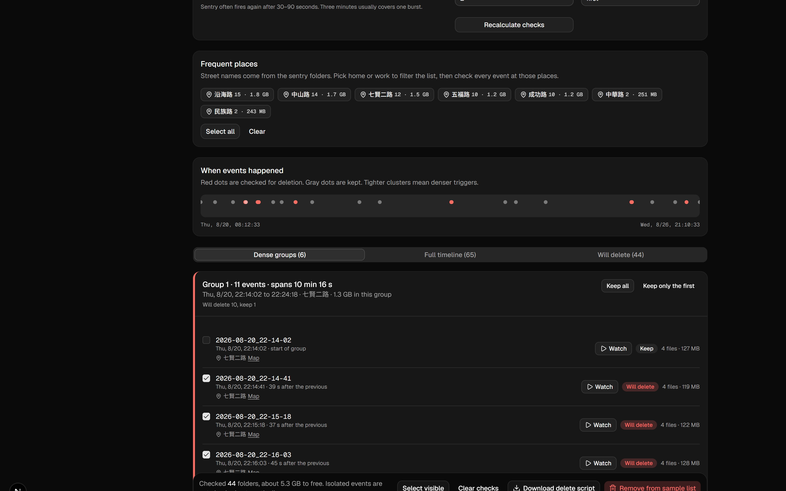

# SentryClips Cleaner

[繁體中文](README.zh-TW.md)

Tesla USB and [teslausb](https://github.com/marcone/teslausb) name each sentry folder with a timestamp, for example `2026-08-20_22-14-02`. People, shadows, and wind often trigger Sentry Mode again within a few minutes and fill `SentryClips` with near-duplicate events.

This tool reads those folder names in the browser, groups events that are close together, and by default keeps only the first clip in each dense group. Check the rest, then delete them or export a PowerShell script for Windows.

Videos stay on your computer. Nothing is uploaded.



Search terms this is meant to match: `SentryClips disk full`, `delete duplicate sentry clips`, `teslausb too many sentry events`.

## Download

On Windows, download the [latest release](https://github.com/elvislin6515/SentryClipsCleaner/releases/latest), unzip it, install [Node.js LTS](https://nodejs.org/), and double-click `start.cmd`. The page opens at `http://127.0.0.1:43147`.

## Run from source

Install [Node.js LTS](https://nodejs.org/), then from this folder:

```bash
npm install
npm run dev -- --port 43147 --hostname 127.0.0.1
```

Open the URL the dev server prints. On Windows you can also double-click `start.cmd` (or `SentryClips清理.cmd`). That script installs dependencies when needed, builds a production copy, and opens `http://127.0.0.1:43147`.

1. Choose the `SentryClips` folder, or scan a local path such as `D:\TeslaCam\SentryClips`.
2. Set how close two events must be (3 minutes by default) and what to keep.
3. Review the red checked rows.
4. Delete from the page when the browser can write, or download the `.ps1` and run it.

`SavedClips` stays out of the list by default so a clip you saved yourself is not removed by mistake.

The page is in English by default. Use **繁中** in the header for Traditional Chinese. The choice is remembered in this browser. A Chinese Windows UI language is picked up on the first visit when you have not chosen a language yet.

## If the folder picker is missing

- Use **Browse for a folder** and select the whole `SentryClips` directory.
- Or paste the output of `dir`.

Those paths can analyze and export a script. They cannot delete files from the page.

## Sample data

**Try the sample week** loads one week of Model X sentry events: people at night, shadows before dawn, and a store parking lot firing in a burst. Deletes in sample mode only change the list on screen.
